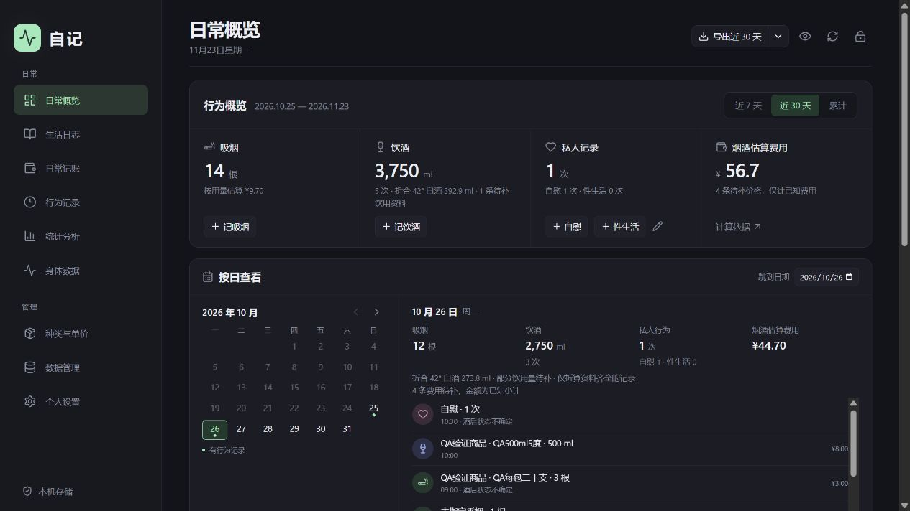

# 自记

自记（Ziji）是一个在 Windows 本机运行的个人日志和记账工具。你可以记下今天上了什么课、为一项待办花了多久、午饭花了多少钱，也可以记录身体测量和个人行为。数据保存在这台电脑的 MySQL 中，日常记录和查询都能离线使用。

*测试数据示例。首页选中近 30 天，日历中点开了 10 月 26 日的明细。*

## 在 Windows 上启动

先安装 JDK 17、Node.js（含 npm）、Maven 和 MySQL 8。将它们的命令加入 `PATH`，包括 MySQL 的 `mysqld`、`mysql` 和 `mysqladmin`。项目使用 Spring Boot、Vue 3、TypeScript 和 ECharts。

1. 下载或克隆仓库，双击根目录的 [start.cmd](start.cmd)。首次启动会下载依赖、构建应用并初始化项目自己的数据库。
2. 浏览器打开后，设置至少 8 位的本地解锁口令。也可以直接打开[本机首页](http://127.0.0.1:17890/)。
3. 以后双击 `start.cmd` 即可使用。双击 [stop.cmd](stop.cmd) 会关闭应用和项目数据库。

**更新已有安装**时，先在“个人设置 → 备份与恢复”导出完整备份。在原项目目录更新源码，保留 `.local/`，然后双击 [rebuild.cmd](rebuild.cmd)。看到构建成功后，再运行 `start.cmd` 打开新版。

## 首页怎么看

首页默认显示近 7 天，也可以切换到近 30 天或累计。选“累计”时，顶部数字汇总从第一笔行为记录到今天的总量，下方折线展示这段时间里每天的吸烟根数、饮酒量（折合 42 度白酒）或私人行为次数。跨度超过 731 天时按月汇总，超过 30 年时按年汇总，图上会标明起止日期和单位。[查看跨年趋势示例（测试数据）](docs/screenshots/全部历史趋势-测试数据.jpg)

点日历中的一天，可以查看当天的行为明细和估算费用。在累计视图中翻月，当月的记录和饮酒关联会随之更新，折线仍覆盖全部历史。没有行为记录的日期计为 0，已有记录缺少价格或饮用量时会标为待补。

## 日常记录

| 页面 | 可以做什么 |
| --- | --- |
| 生活日志 | 按日期、时段或起止时间记饭局、课程、工作和跨日出差。点 `#出差` 标签能找出出差日期，也可按关键词、同行人或地点搜索。 |
| 生活日志 → 全局待办 | 设置截止日期，回看实际完成时间。把工作或学习日志关联到待办后，可以查看每次进展和累计用时。同一待办下，起止时间重叠的部分只计一次。[查看待办示例](docs/screenshots/全局待办与投入时间预览-测试数据.png) |
| 日常记账 | 记录实际收入和支出，按日、月、年看结余和分类排行。从年视图点进月份，再点日期可看当天流水。重复交易可以点“再记一笔”。 |
| 行为记录 | 吸烟按根数、饮酒按场次和本人饮用量记录。选择种类后自动按单价估算费用，缺少种类可当场新增。私人行为可区分自慰和性生活，并回看与饮酒的时间关联。 |
| 身体数据 | 保存身高、体重、体脂率和腰围的测量历史，按同一次测量的身高和体重计算 BMI。 |
| 数据管理 | 搜索、编辑或导出筛选后的记录。打开详情可以核对计算依据，点“操作历史”可以查看修改前后的值。误删的记录可从回收站恢复。 |

买一包烟时，可以把实付金额记在账本里。之后每次记吸烟，首页按“每包单价 ÷ 每包根数 × 本次根数”估算费用，账本只保留实际付款的那一笔。饮酒记录里的代谢时长是模型估算值，不能用来判断能否驾驶。

## 导出一段时间的记录

点页头的“导出近 30 天”，即可下载含今天在内的 30 天 Markdown 报告，包含收支、日志、待办、吸烟、饮酒和身体测量。需要调整时，点按钮右侧的箭头，可选近 7、30、90 天或自定起止日期，勾选想看的类别，也可改为 JSON。私人记录只有主动勾选才会导出。

报告会带上所选记录的备注。想交给 AI 分析时，可以先在本机打开文件，检查内容后再自行分享。迁移或恢复数据请使用“个人设置 → 备份与恢复”。

## 本机数据与开发

网页和数据库都只监听 `127.0.0.1`。网页默认端口为 `17890`，项目独立的 MySQL 端口为 `13316`。首次下载依赖和主动联网更新商品资料时需要网络。数据库、连接配置、备份和日志保存在 Git 忽略的 `.local/` 目录，个人数据需要单独备份。

源码分别位于 `backend/` 和 `frontend/`，构建与验收脚本位于 `scripts/`。`rebuild.cmd` 会检查并构建前端、运行后端测试并打包。数据管理和账本日期的本地逻辑检查可单独运行。接口验收使用独立测试库 `ziji_qa`、测试端口 `17891` 和环境变量 `ZIJI_QA_PASSWORD`。

更多操作见[使用说明](docs/使用说明.md)和[本机验收记录](docs/本机验收记录.md)。早期设计见[本机应用计划书](docs/archive/自记本机应用计划书.md)和[生活日志与待办计划书](docs/archive/生活日志与待办功能计划书.md)。
