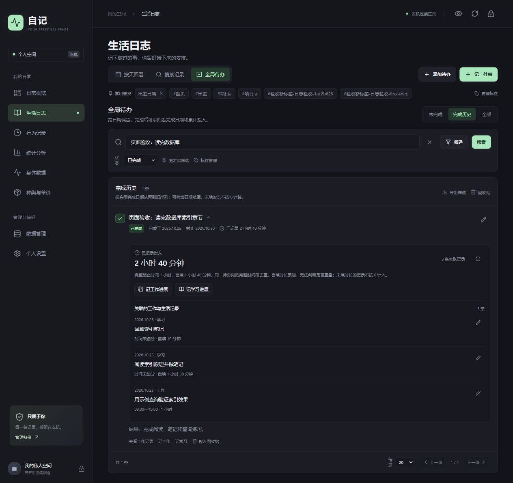

# 自记

自记（Ziji）是一款仅在本机运行的个人记录工具。可以记录生活经历、工作与学习进展、全局待办、身体测量，以及吸烟、饮酒和私人行为，按自己的节奏回看日常。

项目使用 Spring Boot、Vue 3、TypeScript、ECharts 和 MySQL。当前提供 Windows 启动脚本，网页和数据库均只监听 `127.0.0.1`，不提供手机访问或跨设备同步。

- 生活日志支持按天回看、时段或起止时间、跨日事项、同行人、地点、标签、关键词搜索和分页。
- 全局待办支持截止日期、实际完成日期和完成历史；关联工作、学习日志后，可以查看累计投入与每条进展。时长可自动计算或手填，重叠的具体时间会去重。
- 日常记账支持日、月、年收支汇总和分类排行。在年度图中点月份进入月历，点日期查看当天流水。
- 页头可一键导出近 30 天的分析记录，也可自定日期和类别，下载 Markdown 或 JSON。
- 身体数据页保留体重、身高、体脂率和腰围的测量历史，并计算 BMI。
- 行为记录按种类单价与实际用量估算烟酒费用，显示纯酒精量、折合 42 度白酒量及饮酒关联。私人行为区分自慰和性生活。首页默认显示近 7 天，可切换到近 30 天或累计，也可点选日期查看当天的明细。
- 数据管理按用途分组，支持中文搜索、排序、显示列、分页和记录计算依据；保留编辑、回收站、恢复、CSV 导出、完整 JSON 备份和操作历史。

以下预览使用测试数据：



在 Windows 上使用前，需要安装以下工具，并让命令行能从 `PATH` 找到它们：

| 工具 | 要求 |
| --- | --- |
| Java | JDK 17，提供 `java` 命令 |
| Node.js、npm | 用于安装前端依赖和构建页面 |
| Maven | 提供 `mvn` 命令，用于构建和测试后端 |
| MySQL | MySQL 8，提供 `mysqld`、`mysql`、`mysqladmin` 命令 |

1. 下载或克隆仓库，双击根目录的 [start.cmd](start.cmd)。首次启动会自动构建应用、初始化项目独立数据库；首次下载依赖需要联网。
2. 等待浏览器打开 [http://127.0.0.1:17890](http://127.0.0.1:17890)，设置至少 8 位的本地解锁口令。
3. 日常继续使用 `start.cmd`。结束使用时双击 [stop.cmd](stop.cmd)，停止应用和项目数据库。
4. 修改源码后双击 [rebuild.cmd](rebuild.cmd)。构建会检查前端、运行后端测试并打包；完成后再次运行 `start.cmd`。

`scripts/*-check.mjs` 用于接口验收。运行前需单独准备 `ziji_qa` 测试库和 `17891` 测试服务，并设置 `ZIJI_QA_PASSWORD`。这些脚本不用于正式数据库，首次启动也不会自动准备测试环境。

数据库使用项目独立目录和端口 `13316`。应用正常记录可以断网使用；主动更新商品资料时需要联网。酒精估算只用于理解录入数据，不能判断何时清醒或何时可以驾驶。

目录结构：

```text
backend/    Spring Boot 后端、数据库迁移、自动测试
frontend/   Vue 3 前端源码
scripts/    启停、构建和接口验收脚本
docs/       使用说明、计划文档、验收记录及测试截图
.local/     本机数据与配置，运行后生成，Git 忽略
```

`.local/` 包含数据库、连接凭据、备份和日志，已经由 `.gitignore` 排除。依赖目录和构建产物也不进入提交。不要把个人数据库、导出记录或口令配置加入仓库；GitHub 上的源码不能代替数据备份。

日常备份请使用应用内“个人设置 → 备份与恢复”。保留现有安装时，不要删除 `.local/`；重新克隆源码不会带回原来的个人数据。

操作细节见[使用说明](docs/使用说明.md)，已验证的功能与边界见[本机验收记录](docs/本机验收记录.md)。历史设计保存在[本机应用计划书](docs/archive/自记本机应用计划书.md)和[生活日志与待办计划书](docs/archive/生活日志与待办功能计划书.md)。
