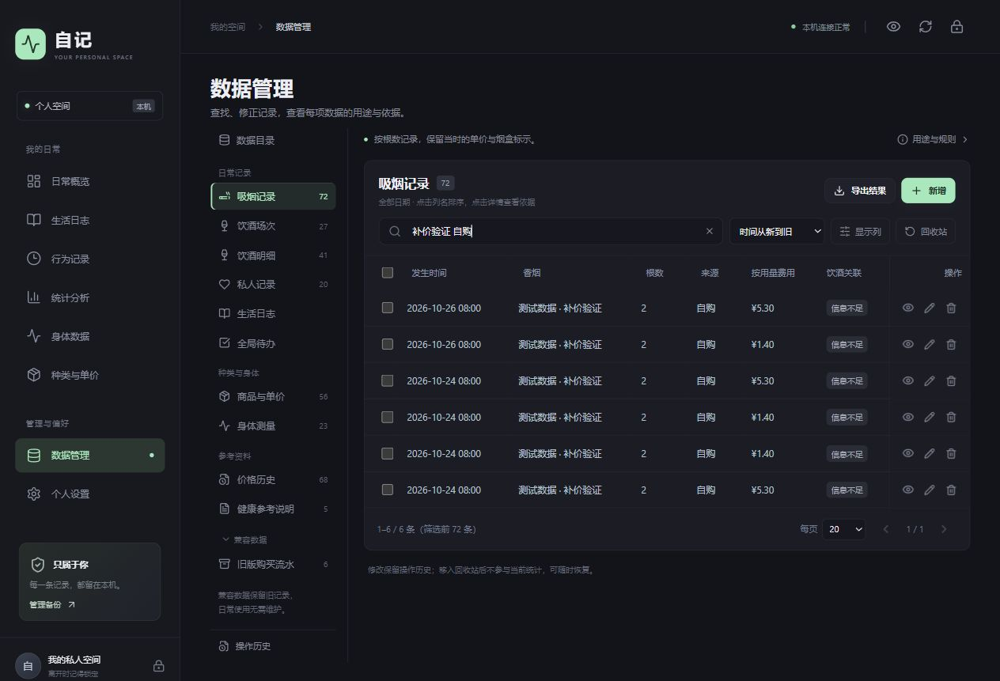

# 每日完整度与个人目标清理记录

2026-11-01 完成，已更新本机程序。

每日完整度和个人目标已从页面、接口、统计处理和数据库中移除。清理前检查了两张旧表，并备份了数据库、旧程序和源码。

## 清理内容

- 通过 V8 迁移删除 `zj_completeness`、`zj_goals`，没有新增业务表。
- 删除两个集合的注册、默认值、专属校验和完整确认去重逻辑，关闭对应的增删改查及恢复接口。
- 删除每日和累计统计中的完整确认字段、确认天数计算，以及用确认日期推断累计起点的逻辑。累计起点由实际行为记录确定。
- 删除管理目录、说明、设置卡片、编辑器默认值、无用样式和前端残留字段；更新相关回归检查。
- 新备份不再包含这两个集合。旧备份仅在导入时识别这两个名称，预览提示跳过条数，其他有效记录照常恢复。

旧版购买流水仍有历史关联，价格历史用于单价追溯，健康参考说明仍供首页和分析页展示，因此保留这些有实际用途的数据。

V1、V3 等已执行的迁移文件保持原样，避免破坏迁移校验。安装或升级执行至 V8 后，数据库中不会留下这两张表。旧备份导入识别和迁移历史不提供这两项功能的入口，也不会重新创建旧表。

## 核对结果

| 检查项 | 结果 |
| --- | --- |
| 正式库旧表 | 两张表均已删除 |
| 其他数据 | 剩余 15 张应用数据表的迁移前后内容摘要一致，包含已删除记录、日志、待办、价格及历史快照 |
| 统计 | 使用同一计算时间，逐项比对新旧程序的最近 7 天、30 天、90 天及累计报告；除主动移除的完整确认字段外，结果一致 |
| 后端测试 | 170 项通过，覆盖旧备份跳过、有效记录恢复、非法集合和大小限制 |
| 管理逻辑 | 22 项检查通过 |
| 接口 | 23 项请求检查通过，废弃接口不可用，新备份不含废弃项 |
| 页面 | 展开兼容区后仅有旧版购买流水，设置页无目标卡片；旧备份预览显示跳过原因与条数 |
| 本机服务 | 新前端正常提供，HTTP 200 |

迁移前的备份和核对结果保存在本机。

