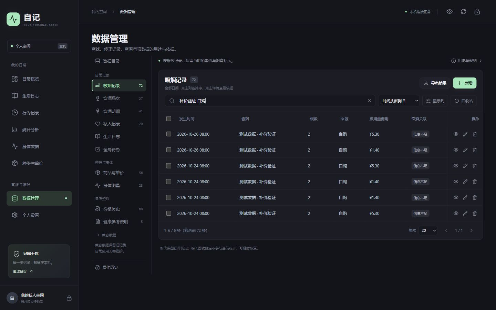

# 数据管理改版计划

日期：2026-11-01

本文记录首轮界面改版。随后按用户要求彻底移除了每日完整度和个人目标，本文涉及“移入兼容区”的处理已由[废弃功能清理记录](废弃功能清理记录.md)替代。

## 检查结论

现有页面将 13 个数据集合平铺为按钮，饮酒场次、商品价格、旧版确认标记处于同一层级。表格只显示部分字段，详情则直接显示 JSON，用户很难判断数据用途、来源和计算关系。搜索直接匹配原始数据，关联的商品名称、中文枚举值不一定能搜到；切换筛选或翻页后，批量选择状态也容易混淆。

| 现有项目 | 代码中的实际作用 | 本次处理 |
| --- | --- | --- |
| 每日完整度 | 保存某日某类行为是否人工确认完整，后端仍返回确认天数；当前趋势已采用未记录日期按 0 的口径 | 改名为“旧版完整确认”，移入折叠的兼容数据区，并从行为记录主入口移除 |
| 个人目标 | 保存目标值；设置页可以编辑，但没有达标进度、目标驱动提醒或自动干预 | 改名为“目标备忘”，明确仅保存备忘；移入兼容区，设置页不再展示无数据的目标卡片 |
| 健康资料 | 首页提示和统计分析页的参考说明及来源 | 改名为“健康参考说明”，归入参考资料，说明它与身体测量的区别 |
| 价格历史 | 保存历史或参考价格；现行计价以商品已确认单价为主，旧价格仍可能作为兼容来源 | 移入参考资料，说明改价入口和历史重算规则 |
| 购买流水 | 保留早期付款资料及关联，当前主页费用按用量计算 | 移入兼容区，不要求日常录入 |

以上判断依据 `SchemaRegistry`、`BehaviorCalculator`、`DataManager`、`Settings`、`Dashboard` 和 `Analytics` 的现有实现。

## 参考与取舍

[NocoDB 的界面说明](https://nocodb.com/docs/product/getting-started/terminologies)将数据表导航、当前视图工具和记录区域分开；[DBeaver 的数据面板](https://dbeaver.com/docs/dbeaver/Panels/)提供独立的值、元数据和引用详情。[DBeaver 的过滤说明](https://dbeaver.com/docs/dbeaver/Data-Filters/)则将筛选放在表格附近。

本项目采用分组目录、表格工具栏和侧边详情。保留现有深色风格，减少大按钮、重复标题和装饰留白。日常用户不需要 SQL 输入框或数据库管理权限，这些能力不纳入本次改动。

## 实施范围

1. 桌面使用窄侧栏分类导航，分为日常记录、种类与身体、参考资料和默认折叠的兼容数据。窄窗口改为分类选择框，避免横向堆叠导航。
2. 表格提供中文内容搜索、排序、显示列、每页条数和明确的当前结果计数。搜索和分页变化时清空批量选择；删除后页码自动回到有效范围。
3. 每类数据显示一句用途，并提供可展开的用途与计算说明。常规记录详情先展示中文字段、计算结果和保存时采用的价格/规格，原始 JSON 放到折叠区。
4. 费用解释使用记录保存的单价，不用今天的商品价格冒充历史价格。说明吸烟根数计费、本人饮用量、纯酒精及 42° 白酒换算。缺失值保留“未填写/待补”，不伪装成 0。
5. 保留生活日志和全局待办现有的分页、检索、截止日期、完成日期及投入时长逻辑，嵌入新的管理框架。
6. 操作历史继续可查，默认用可读的操作列表展示。回收站、恢复、编辑、导出、历史重算保留。

## 方案自评

| 检查点 | 评估与决定 |
| --- | --- |
| 是否应直接删掉看似无用的表 | 不采用。完整确认和价格资料仍有兼容引用，健康说明仍在展示；删除会损失资料或改变历史解释 |
| 是否要补做目标系统 | 不纳入。用户本次要求整理和解释数据，贸然增加提醒与打分会扩大范围 |
| 是否增加数据库实体 | 不增加。分类、字段说明、筛选和显示列属于界面配置；计算结果沿用现有接口 |
| 是否改变历史费用和统计 | 不改变。此次只整理展示和查询交互，公式说明对照现有计算代码 |
| 窄侧栏是否挤压表格 | 用小宽度目录、可选列和表格内部横向滚动，窄屏切换选择框；页面本身不应横向溢出 |
| 如何验证数据安全 | 正式更新前备份数据库和旧程序，更新后比较业务表数据摘要；真实数据不用于截图或测试写入 |

## 验收条件

- 首屏不再出现跨行的 13 个分类按钮，旧版入口默认折叠。
- 常用记录可搜索中文商品名和选项文字，分页、排序、列切换、回收站正常。
- 记录详情能解释保存的数据与计算结果，原始数据仍可查看。
- 日志与待办可正常打开，原有编辑与数据管理功能保留。
- 前端编译通过，在独立测试空间检查实际页面、增删改查与恢复。
- 正式更新不新增数据库表，不迁移、不改写个人业务记录。

## 实施与验收结果

以上改动已于 2026-11-01 完成并更新到本机程序。此次没有修改后端计算代码、数据库表结构或备份格式。

- 前端构建通过，22 项界面逻辑检查通过，原有 164 项后端测试通过。
- 在独立测试空间验证了中文多词搜索、分页、数值排序、显示列、筛选清空选择、详情公式、操作历史，以及新增、编辑、回收站和恢复。
- 筛选后的 6 条测试记录成功导出为 CSV；导出包含全部字段。日志与全局待办原有入口正常。
- 检查了桌面和 390 像素窄窗口布局。窄窗口采用分类选择框，表格在自身区域滚动，页面没有横向溢出。浏览器未报告警告或错误。
- 正式更新前备份数据库和旧程序；更新前后对完整数据库的数据导出计算摘要，结果一致。新前端已由本机服务提供，返回 HTTP 200。

本机备份与更新核对结果保存在忽略上传的 `.local/upgrades/` 中。

